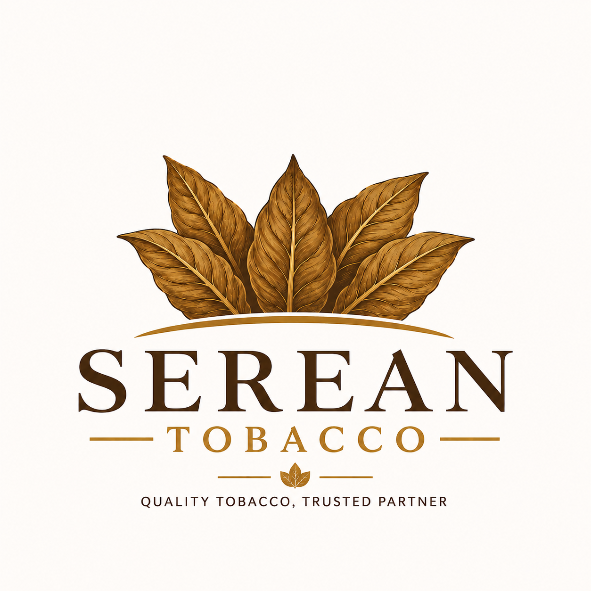

<p align="center">
  
</p>

<h1 align="center">Serean Tobacco — Sentra Tembakau Nusantara</h1>

<p align="center">
  Platform web resmi <strong>Serean Tobacco</strong>, penyedia jasa pengolahan (perajangan & pengeringan) serta perdagangan daun tembakau berkualitas pilihan dari sentra lereng Gunung Sumbing, Temanggung, dan berbagai daerah Nusantara.
</p>

<p align="center">
  
  
  
  
  
</p>

---

## 📋 Daftar Isi

1. [Tech Stack yang Digunakan](#-tech-stack-yang-digunakan)
2. [Halaman & Fitur Utama](#-halaman--fitur-utama)
3. [Prasyarat Sistem (Prerequisites)](#-prasyarat-sistem-prerequisites)
4. [Panduan Instalasi (Mulai dari Awal Clone)](#-panduan-instalasi-mulai-dari-awal-clone)
5. [Menjalankan Aplikasi](#-menjalankan-aplikasi)
6. [Pengujian & Format Kode](#-pengujian--format-kode)
7. [Struktur Direktori](#-struktur-direktori)
8. [Lisensi](#-lisensi)

---

## 🛠 Tech Stack yang Digunakan

### **Backend**
- **Framework**: [Laravel 13](https://laravel.com/)
- **Bahasa Pemrograman**: [PHP 8.3+](https://www.php.net/) (Support hingga PHP 8.6)
- **Database**: [SQLite](https://www.sqlite.org/) (Default bawaan yang ringan & siap pakai) / Mendukung [MySQL](https://www.mysql.com/) & [PostgreSQL](https://www.postgresql.org/)
- **Testing Suite**: [Pest PHP 5.x](https://pestphp.com/) (Feature & Unit testing)
- **Code Formatter**: [Laravel Pint](https://laravel.com/docs/pint) (Standar styling PSR-12 & Laravel)

### **Frontend**
- **Templating Engine**: Laravel Blade
- **CSS Framework**: [Tailwind CSS v4](https://tailwindcss.com/) dengan `@tailwindcss/vite`
- **Build Tool / Bundler**: [Vite 8](https://vite.dev/) & `laravel-vite-plugin`
- **Animasi & Interaksi**:
  - [AOS (Animate On Scroll)](https://michalsnik.github.io/aos/) untuk efek transisi scroll halus
  - Hero Background Auto-Slider (Sinkronisasi gambar panen & narasi setiap 5 detik)
  - Horizontal Product Carousel (Menampilkan pas 3 produk per view tanpa terpotong)
- **Ikonografi & Tipografi**:
  - [Font Awesome 6 (Free Solid, Brands)](https://fontawesome.com/)
  - Google Fonts (Lora untuk judul bernuansa otentik tembakau & Plus Jakarta Sans untuk teks isi yang modern)

---

## 🌿 Halaman & Fitur Utama

| Rute / URL | Halaman | Deskripsi |
| :--- | :--- | :--- |
| `/` | **Beranda (Landing Page)** | Hero section adaptif mobile dengan logo permanen, statistik 3-kolom standar mutu (Kadar air 12–14%, 25+ Varietas, Timbangan 100%), cuplikan Tentang Kami, carousel katalog 3 produk, testimoni customer, dan bagian Tanya Jawab (FAQ) interaktif dengan dropdown accordion. |
| `/tentang` | **Tentang Kami** | Filosofi Lereng Gunung Sumbing & Sindoro, 4 pilar mutu tembakau murni bebas kimia, dan 4 tahapan alur pascapanen (*Petik, Rajang, Jemur Curing, Grading*). |
| `/produk` | **Katalog Produk** | Tab filter kategori varietas (*Semua, Temanggung & Sumbing, Jawa Timur, Grade Eksklusif*), kartu spesifikasi rinci (karakter rasa, kadar air, potongan rajang, harga mulai), dan tombol pesan otomatis terintegrasi. |
| `/kontak` | **Kontak Kami** | Direktori kontak resmi per baris (Desa Kalisari, Banyuglugur, Situbondo, WhatsApp Resmi 0878-5532-0286 Rajif Fakhri / Feri, Email Kemitraan) tanpa form yang rumit, lengkap dengan tombol direct chat WhatsApp & Google Maps. |

---

## 💻 Prasyarat Sistem (Prerequisites)

Sebelum menginstal proyek, pastikan perangkat Anda telah terpasang:

1. **PHP**: Versi **8.3** atau yang lebih baru (disarankan PHP 8.4+).
   - Ekstensi PHP yang wajib aktif: `pdo`, `pdo_sqlite` (atau `pdo_mysql`), `mbstring`, `openssl`, `tokenizer`, `xml`, `ctype`, `curl`, `fileinfo`.
2. **Composer**: Versi **2.x** ([Unduh Composer](https://getcomposer.org/)).
3. **Node.js**: Versi **18.x** atau **20.x+** dan **npm** ([Unduh Node.js](https://nodejs.org/)).
4. **Git**: Untuk melakukan kloning repository ([Unduh Git](https://git-scm.com/)).

---

## 🚀 Panduan Instalasi (Mulai dari Awal Clone)

Ikuti langkah-langkah berikut secara berurutan untuk menjalankan proyek di komputer lokal:

### 1. Kloning Repository
Buka terminal (Git Bash, Command Prompt, atau PowerShell) dan jalankan:
```bash
git clone https://github.com/username/serean-tobacco.git
cd serean-tobacco
```

### 2. Install Dependensi PHP (Composer)
Jalankan perintah berikut untuk mengunduh semua library dan framework Laravel:
```bash
composer install
```

### 3. Konfigurasi File Lingkungan (`.env`)
Salin file contoh `.env.example` menjadi `.env`:
- **Di Linux / macOS / Git Bash**:
  ```bash
  cp .env.example .env
  ```
- **Di Windows PowerShell**:
  ```powershell
  copy .env.example .env
  ```

### 4. Generate Application Encryption Key
Buat kunci enkripsi aplikasi Laravel:
```bash
php artisan key:generate
```

### 5. Setup Database & Jalankan Migrasi
Secara default, aplikasi menggunakan database **SQLite**. Pastikan file database telah tersedia lalu jalankan migrasi tabel:
- **Di Linux / macOS / Git Bash**:
  ```bash
  touch database/database.sqlite
  php artisan migrate
  ```
- **Di Windows PowerShell**:
  ```powershell
  if (!(Test-Path database\database.sqlite)) { New-Item database\database.sqlite -ItemType File }
  php artisan migrate
  ```
> *Catatan: Jika ingin menggunakan MySQL, ubah konfigurasi `DB_CONNECTION=mysql` dan sesuaikan nama database serta password pada file `.env`.*

### 6. Install Dependensi Frontend (npm)
Install seluruh paket JavaScript, Tailwind CSS v4, dan Vite:
```bash
npm install
```

### 7. Kompilasi Aset Frontend
Lakukan build aset statis (CSS & JS):
```bash
# Untuk kompilasi production:
npm run build
```

---

## 🏃 Menjalankan Aplikasi

Anda dapat menjalankan server pengembangan lokal dengan salah satu cara berikut:

### Cara 1: Menggunakan Perintah All-in-One (Rekomendasi)
Menjalankan PHP server dan Vite dev server secara bersamaan dalam satu terminal:
```bash
composer run dev
```

### Cara 2: Menjalankan Secara Terpisah
- **Terminal 1** (Server Backend Laravel):
  ```bash
  php artisan serve
  ```
- **Terminal 2** (Vite Dev Server untuk Hot Reload):
  ```bash
  npm run dev
  ```

Buka browser Anda dan akses aplikasi di:
```
http://127.0.0.1:8000
```

---

## 🧪 Pengujian & Format Kode

### 1. Menjalankan Automated Tests (Pest PHP)
Proyek ini dilengkapi dengan pengujian otomatis untuk memastikan seluruh rute halaman mengembalikan kode status HTTP 200 OK:
```bash
php artisan test
```
atau langsung melalui binary Pest:
```bash
vendor/bin/pest
```

### 2. Memeriksa & Merapikan Format Kode (Laravel Pint)
Format seluruh kode PHP agar sesuai standar bersih Laravel:
```bash
vendor/bin/pint
```

---

## 📁 Struktur Direktori Penting

```text
serean-tobacco/
├── app/                        # Logika inti aplikasi Laravel
├── database/                   # Migrasi skema database & SQLite file
│   └── database.sqlite
├── public/                     # Aset publik (logo.png, gambar produk, hero)
│   ├── images/
│   │   ├── hero/               # Foto daun tembakau, panen, curing
│   │   ├── products/           # Foto varietas tembakau (Virginia, Sumbing, dll.)
│   │   └── testimonials/       # Foto avatar customer
│   └── logo.png                # Logo resmi Serean Tobacco
├── resources/
│   ├── css/                    # Konfigurasi Tailwind CSS v4
│   ├── js/                     # Skrip JavaScript frontend
│   └── views/                  # Template Blade aplikasi
│       ├── components/
│       │   └── navbar.blade.php    # Komponen navbar responsif
│       ├── layouts/
│       │   └── app.blade.php       # Layout induk utama & footer
│       ├── landing.blade.php       # Halaman Beranda
│       ├── tentang.blade.php       # Halaman Tentang Kami
│       ├── produk.blade.php        # Halaman Katalog Produk
│       └── kontak.blade.php        # Halaman Kontak & Pemesanan
├── routes/
│   └── web.php                 # Pendaftaran rute URL (/ , /tentang, /produk, /kontak)
├── tests/
│   └── Feature/                # Pengujian Pest untuk seluruh halaman
├── composer.json               # Konfigurasi dependensi PHP
├── package.json                # Konfigurasi dependensi npm & Tailwind v4
└── vite.config.js              # Konfigurasi bundler Vite 8
```

---

## 📄 Lisensi

Proyek ini dibangun untuk **Serean Tobacco — Desa Kalisari, Kec. Banyuglugur, Kab. Situbondo, Jawa Timur**. Seluruh aset dan hak cipta dilindungi undang-undang. Framework Laravel dilisensikan di bawah [MIT license](https://opensource.org/licenses/MIT).
